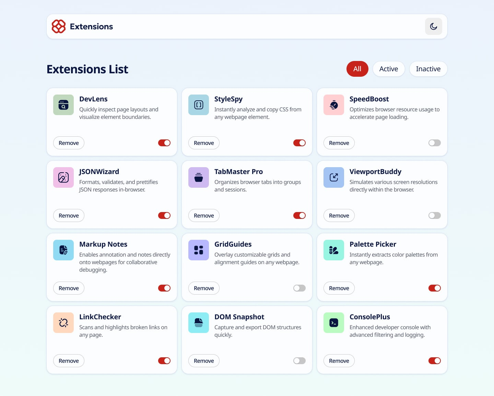
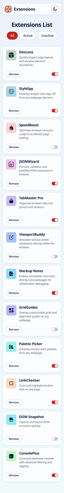

# Browser Extensions Manager UI

A responsive browser extensions manager built as a solution to the **Browser Extensions Manager UI** challenge from Frontend Mentor.

The project allows users to manage browser extensions through a clean and interactive interface, with support for light and dark themes.

## 📸 Preview

### Desktop View



### Mobile View



## ✨ Features

- View a list of browser extensions.
- Filter extensions by All, Active, and Inactive.
- Activate and deactivate extensions.
- Remove extensions from the list.
- Switch between Light and Dark themes.
- Save the selected theme using Local Storage.
- Responsive design for desktop and mobile devices.
- Interactive hover and focus states.

## 🛠️ Built With

- HTML5
- CSS3
- JavaScript (Vanilla JS)
- Bootstrap 5
- Font Awesome
- Local Storage API

## 📂 Project Structure

```text
browser-extensions-manager/
├── css/
│   ├── fonts.css
│   ├── index.css
│   ├── public.css
│   ├── reset.css
│   └── varilabel.css
│
├── data/
│   └── data.json
│
├── fonts/
│
├── images/
│
├── javascript/
│   └── script.js
│
├── vender/
│   └── bootstrap/
│
├── index.html
└── README.md

```

## 💡 What I Learned

While building this project, I practiced:

- DOM manipulation and event handling.
- Array methods such as `map()`, `filter()`, and `find()`.
- Event delegation.
- Managing application state with JavaScript.
- Working with Local Storage.
- Creating a theme switcher.
- Building responsive layouts with Bootstrap.
- Organizing JavaScript code into reusable functions.

## 🙏 Acknowledgments

- [Frontend Mentor](https://www.frontendmentor.io/) for providing the challenge and design.
- ChatGPT for helping me understand concepts, debug issues, and improve my problem-solving skills throughout the development process.

## ⚙️ Getting Started

To run this project locally:

1. Clone the repository:

   ```bash
   git clone YOUR_REPOSITORY_URL
   ```

2. Open the project folder.

3. Run the project using a local development server, such as the VS Code Live Server extension.

## 🎯 Challenge

This project was built as part of a challenge from [Frontend Mentor](https://www.frontendmentor.io/).

## 👩‍💻 Author

<a href="https://github.com/kazemhazara">
  
</a>

## 📫 Connect with Me

<p align="left">
  <a href="mailto:kaz.hazara@gmail.com">
    
  </a>
  <a href="https://wa.me/kazemhazara">
    
  </a>
  <a href="https://www.linkedin.com/in/kazemhazara">
    
  </a>
</p>

## 🚀 Live Demo

[View Live Demo](https://kazemhazara.github.io/browser-extensions-manager/)
